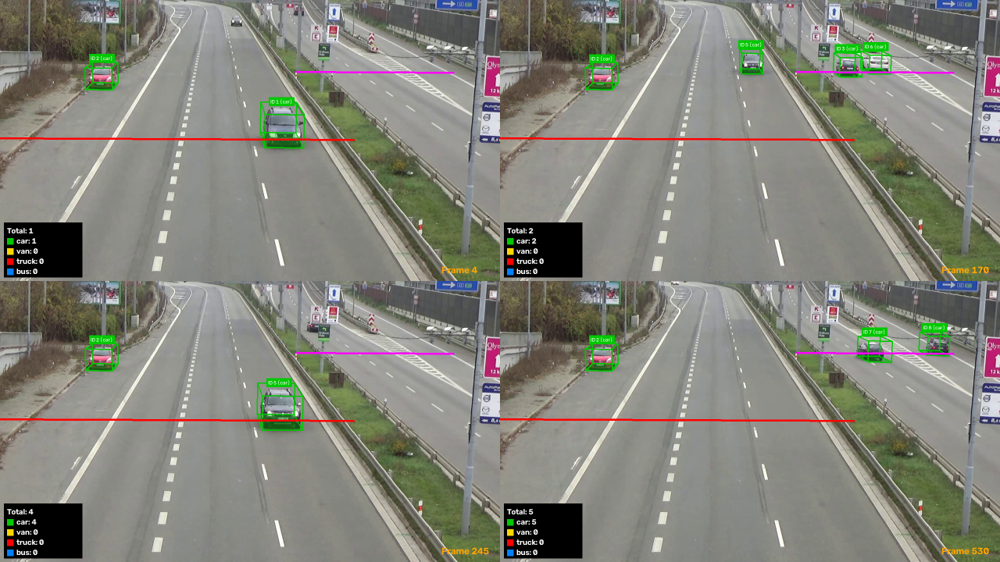
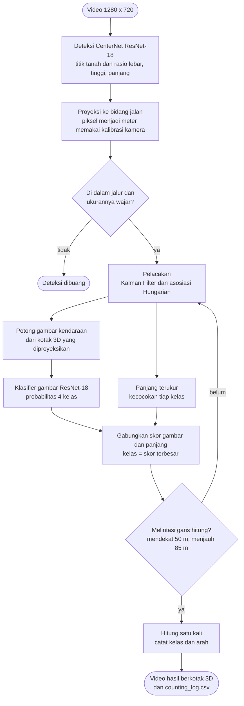
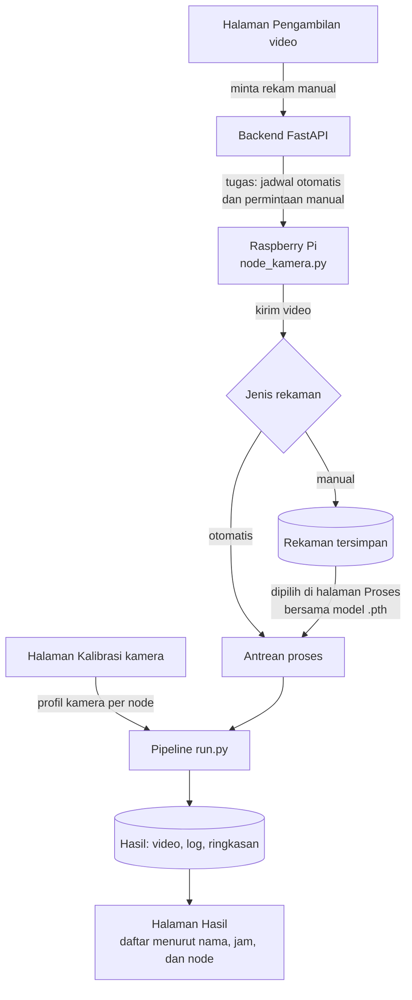
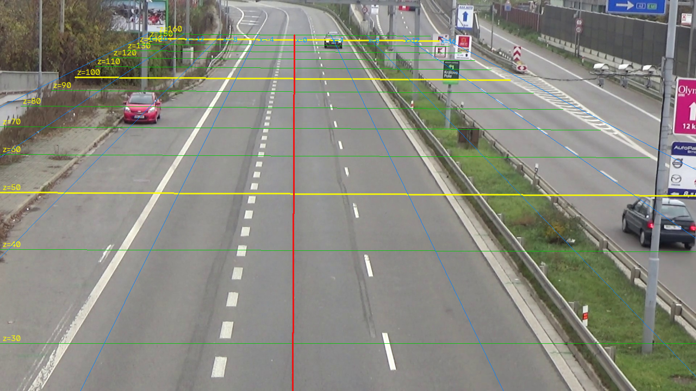
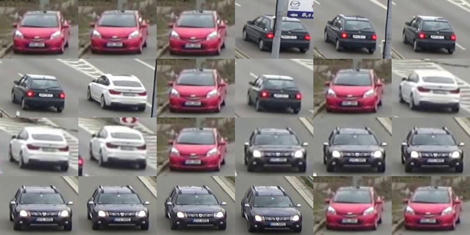

# 3D Vehicle Detection, Classification, and Counting

Pipeline deteksi kotak 3D, pelacakan, klasifikasi 4 kelas, dan penghitungan kendaraan dari satu kamera jalan raya, dilengkapi antarmuka web. Dikerjakan sebagai Tugas Akhir oleh Angeleno Zuliano Hutapea.

Detektor yang dipakai adalah CenterNet (ResNet-18) yang meregresikan kotak 3D kendaraan, tanpa YOLO. Kode berangkat dari proyek [antoinekeller/3d_bbox_highway](https://github.com/antoinekeller/3d_bbox_highway).



> **Status:** repo ini berisi tahap latihan memakai data publik `session0_right`. Kamera milik proyek belum terpasang; saat terpasang, kalibrasi, letak garis, dan bobot model perlu disesuaikan (lihat [Pindah ke kamera sendiri](#pindah-ke-kamera-sendiri)).

## Daftar isi

- [Cara kerja](#cara-kerja)
- [Struktur folder](#struktur-folder)
- [Yang tidak ada di repo ini](#yang-tidak-ada-di-repo-ini)
- [Pemasangan](#pemasangan)
- [Menjalankan pipeline](#menjalankan-pipeline)
- [Antarmuka web](#antarmuka-web)
- [Evaluasi hitungan terhadap ground truth](#evaluasi-hitungan-terhadap-ground-truth)
- [Hasil](#hasil)
- [Melatih ulang model](#melatih-ulang-model)
- [Setelan penting](#setelan-penting)
- [Keterbatasan](#keterbatasan)
- [Pindah ke kamera sendiri](#pindah-ke-kamera-sendiri)
- [Rujukan](#rujukan)

## Cara kerja



| Tahap | Berkas | Keterangan |
|---|---|---|
| Deteksi | `detector.py` | CenterNet ResNet-18, stride 32. Keluarannya titik sentuh tanah kendaraan dan rasio lebar/tinggi/panjang; tidak ada kotak 2D. |
| Proyeksi dan filter | `geometry.py`, `detection_filter.py` | Titik piksel diproyeksikan ke bidang jalan memakai kalibrasi kamera, sehingga posisi dan ukuran didapat dalam meter. Deteksi di luar jalur atau berukuran tidak wajar dibuang. |
| Pelacakan | `tracker.py`, `kalman_filter.py` | Kalman Filter kecepatan konstan dan asosiasi Hungarian. Asosiasi dua tahap ala ByteTrack aktif bila `--conf-low` diberikan. |
| Kotak 3D tampilan | `box3d.py` | Ukuran kotak = campuran templat kelas dan ukuran terukur; arah dari lintasan. |
| Klasifikasi | `classifier.py`, `klasifikasi_gambar.py` | Empat kelas: `car`, `van`, `truck`, `bus`. Probabilitas klasifier gambar (ResNet-18) digabung dengan prior panjang terukur, dirata-rata sepanjang hidup track. |
| Penghitungan | `counter.py` | Kendaraan dihitung satu kali saat melintasi garis virtual. Ada dua garis: satu untuk jalur yang mendekat, satu untuk jalur yang menjauh. |
| Tampilan | `visualize.py` | Kotak 3D, label, dan panel hitungan berwarna per kelas. |

### Klasifikasi: gambar digabung panjang

Detektor hanya punya satu kanal heatmap, jadi tidak membedakan jenis kendaraan. Kelas ditentukan dari dua bukti:

1. **Gambar.** Potongan gambar kendaraan diambil dari kotak 3D yang diproyeksikan ke citra, lalu diklasifikasi ResNet-18 (masukan 128 × 128, letterbox).
2. **Panjang terukur.** Tiap kelas punya rentang panjang (`LIMITS` di `config.py`); di dalam rentang prior bernilai 1 dan meluruh di luarnya.

Skor per kelas:

```
skor[c] = (rata-rata probabilitas gambar[c] + ε) × (rata-rata prior panjang[c] + ε)
```

Kelas akhir adalah skor terbesar. Panjang tidak bisa membedakan `truck` dan `bus` (rentangnya tumpang tindih), jadi keduanya hanya dibedakan oleh gambar. Dengan opsi `--tanpa-gambar`, kelas ditentukan dari panjang saja.

### Warna per kelas

| Kelas | Warna kotak |
|---|---|
| `car` | hijau |
| `van` | kuning |
| `truck` | merah |
| `bus` | biru |

## Struktur folder

```
.
├── uji_session0_pipeline/   pipeline lengkap (deteksi sampai counting) untuk data session0_right
│   ├── run.py               program utama
│   ├── config.py            semua setelan: kalibrasi, ambang, kelas, garis hitung, warna
│   ├── tools/               alat bantu (penyetel kalibrasi, pemeriksa kalibrasi, dll.)
│   └── tests/
├── latih_detektor/          latihan dan evaluasi detektor CenterNet
│   ├── train_session0_right.py
│   ├── kamera.py, target.py, dekode.py
│   └── prediksi.py, evaluasi.py, analisis_galat.py
├── latih_klasifikasi/       latihan klasifier gambar 4 kelas
│   ├── siapkan_mio_tcd.py   menyusun dataset dari MIO-TCD
│   ├── potong_session0.py   memotong gambar kendaraan dari frame session0_right
│   └── latih_klasifikasi.py
├── antarmuka/               antarmuka web
│   ├── backend/             app.py (server FastAPI), layanan.py (logika), pratinjau_kalibrasi.py, jalankan.sh
│   ├── frontend/            index.html, gaya.css, aplikasi.js
│   └── node/                node_kamera.py, program untuk Raspberry Pi
├── alat/                    skrip bantu
│   ├── hitung_gt.py         hitungan ground truth dari anotasi dan perbandingan dengan pipeline
│   ├── pasang_*.py          patch yang pernah dipasang ke pipeline (arsip) dan pemasang antarmuka
│   └── rapikan_folder.py, bersihkan_repo_utama.py
├── hasil/                   log latihan, hasil prediksi, gambar, hasil counting
└── requirements_3dbbox.txt
```

Skrip memakai path tetap `~/projects/...` dan `~/dataset_publik/...`. Bila repo diletakkan di tempat lain, sesuaikan path di `uji_session0_pipeline/config.py` dan di nilai bawaan argumen skrip.

## Yang tidak ada di repo ini

Berkas berikut tidak disertakan karena ukurannya besar atau bukan milik proyek ini:

| Berkas | Lokasi yang diharapkan | Keterangan |
|---|---|---|
| Bobot detektor `centernet_dari_baru.pth` | `~/projects/bobot/detektor/` | hasil latihan sendiri pada session0_right |
| Bobot klasifier `klas_ft2.pth` | `~/projects/bobot/klasifikasi/` | hasil latihan sendiri |
| Data `session0_right` | `~/projects/data_session0_right/` | 3.182 frame 1920 × 1080 dengan anotasi kotak 3D per frame (XML) dan berkas kalibrasi kamera |
| Dataset klasifikasi | `~/dataset_publik/dataset_klasifikasi/` | 40.000 gambar dari MIO-TCD, disusun menjadi 4 kelas |
| Video uji | `~/projects/video_uji/` | dibuat dari frame 2545–3181 session0_right |
| Rekaman dari node | `~/projects/video_rekaman/` | video yang dikirim Raspberry Pi atau diunggah lewat antarmuka |
| Setelan antarmuka | `~/projects/antarmuka/data/` | dibuat saat server pertama dijalankan; berisi token node, jadi tidak diunggah |

## Pemasangan

Diuji pada Ubuntu dengan Python 3.12, tanpa GPU.

```bash
python3 -m venv ~/projects/venv_3dbbox
source ~/projects/venv_3dbbox/bin/activate
pip install -r requirements_3dbbox.txt
pip install fastapi uvicorn python-multipart     # untuk antarmuka web
sudo apt install ffmpeg        # opsional: agar video hasil berformat H.264
```

## Menjalankan pipeline

```bash
cd ~/projects/uji_session0_pipeline
python3 run.py ~/projects/video_uji/uji_val_720p.mp4 \
    ~/projects/bobot/detektor/centernet_dari_baru.pth \
    --cache ~/projects/video_uji/det_session0.pkl \
    --conf 0.4 --conf-low 0.2 --no-show --line-y 50
```

Keluaran:

- video hasil di `~/projects/hasil/video/<nama_video>_hasil.mp4`;
- `counting_log.csv`: satu baris per kendaraan yang dihitung (frame, ID, kelas, ukuran, posisi, skor tiap kelas);
- ringkasan hitungan per kelas di terminal.

Video masukan harus 1280 × 720, sesuai kalibrasi dan detektor.

| Opsi | Fungsi |
|---|---|
| `--conf` | ambang skor deteksi yang boleh membuat track baru |
| `--conf-low` | ambang skor rendah; deteksi di antaranya hanya menyambung track yang sudah ada |
| `--cache BERKAS` | simpan atau muat deteksi mentah, sehingga jalan berikutnya jauh lebih cepat |
| `--line-y` | garis hitung jalur yang mendekat (meter dari kamera) |
| `--line-y-away` | garis hitung jalur yang menjauh (bawaan 85 m) |
| `--klas BERKAS` | bobot klasifier gambar |
| `--tanpa-gambar` | klasifikasi dari panjang saja |
| `--simpan-crop FOLDER` | simpan potongan gambar yang dikirim ke klasifier, untuk diperiksa |
| `--out BERKAS` | nama video hasil |
| `--png` | simpan juga PNG tiap frame |
| `--no-save` | tidak menyimpan video |
| `--no-show` | tanpa jendela pratinjau |
| `--debug` | tandai deteksi mentah yang lolos dan yang ditolak filter |

## Antarmuka web

Antarmuka menjalankan `run.py` yang sama dengan terminal, jadi hasilnya sama. Backend memakai FastAPI; halaman web memakai HTML, CSS, dan JavaScript biasa tanpa pustaka tambahan.

```bash
~/projects/antarmuka/backend/jalankan.sh
```

Lalu buka `http://127.0.0.1:8000` di peramban.

Alur dari kamera sampai halaman Hasil:



| Halaman | Fungsi |
|---|---|
| Pengambilan video | Memilih node, melihat status Raspberry Pi, melihat jadwal otomatis, merekam manual, mengunggah video, dan melihat daftar rekaman. |
| Kalibrasi kamera | Mengatur sudut, tinggi, dan focal kamera per node dengan pratinjau langsung, atau mengunggah berkas kalibrasi. Garis hitung, median, dan lebar jalur juga diatur di sini. |
| Proses | Memilih video, profil kamera (node), dan bobot model `.pth`, lalu memprosesnya. |
| Hasil | Daftar semua video yang diproses, disaring menurut nama, tanggal rekam, dan node. Tiap hasil menampilkan video, hitungan per kelas dan arah, grafik, dan tabel kendaraan. |

### Pengambilan video

- **Otomatis.** Jadwalnya tetap dan ditulis di `antarmuka/data/setelan.json` (bawaan 6 video per hari, 60 detik per video, pukul 06.00–18.00). Halaman hanya menampilkannya. Rekaman otomatis langsung diproses.
- **Manual.** Direkam saat tombol ditekan, atau diunggah dari berkas. Rekaman manual hanya disimpan, lalu dipilih sendiri saat ingin diproses.

### Node kamera (Raspberry Pi)

Raspberry Pi menjalankan `antarmuka/node/node_kamera.py`, yang hanya memakai pustaka bawaan Python. Program itu bertanya ke server tiap 5 detik, merekam pada jam jadwal atau saat ada permintaan manual, lalu mengirim videonya.

```bash
# di Raspberry Pi (kamera asli)
python3 node_kamera.py --server http://ALAMAT_SERVER:8000 --node kamera1 --token TOKEN

# uji tanpa kamera: kamera tiruan dari berkas video (butuh ffmpeg)
python3 node_kamera.py --server http://127.0.0.1:8000 --node kamera1 --token TOKEN \
    --sumber ~/projects/video_uji/uji_val_720p.mp4
```

`TOKEN` adalah nilai `token_node` di `antarmuka/data/setelan.json` pada server. Agar Raspberry Pi bisa mengirim dari jaringan, ubah `izinkan_jaringan` menjadi `true` di berkas itu lalu mulai ulang server.

### Profil kamera

Kalibrasi dan garis hitung disimpan per node di `antarmuka/data/kamera/<node>.json`. Saat sebuah video diproses, profil node-nya diberikan ke pipeline lewat variabel lingkungan `PROFIL_KAMERA`, dan `config.py` menimpa nilai bawaannya dengan isi profil itu. Tanpa variabel tersebut, `config.py` berlaku apa adanya.

### Keamanan

Halaman web dan API-nya hanya melayani komputer server sendiri (`127.0.0.1`). Dari jaringan, yang dilayani hanya alamat `/api/node/...` untuk Raspberry Pi, dan itu wajib membawa token.

## Evaluasi hitungan terhadap ground truth

`alat/hitung_gt.py` menghitung jumlah kendaraan yang sebenarnya melintasi garis dari anotasi XML, lalu mencocokkannya dengan `counting_log.csv`. Anotasi tidak memuat ID antar-frame, jadi skrip menghubungkan sendiri objek antar-frame di bidang jalan.

```bash
cd ~/projects/uji_session0_pipeline
python3 ~/projects/alat/hitung_gt.py --first 2545 --last 3181 --line 50 --log counting_log.csv
```

Skrip melaporkan TP, FP, FN, presisi, recall, dan selisih panjang terukur terhadap anotasi.

## Hasil

Diuji pada frame 2545–3181 `session0_right` (637 frame, sekitar 25 detik). Rentang ini tidak dipakai saat melatih detektor.

| Ukuran | Nilai |
|---|---|
| Kendaraan melintasi garis menurut anotasi | 6 (2 mendekat, 4 menjauh) |
| Dihitung pipeline | 6 |
| TP / FP / FN | 6 / 0 / 0 |
| Kelas | 6 `car`, sesuai isi klip |
| Skor kelas `car` | 0,96–0,98 |
| Selisih panjang di garis 50 m | +0,3 sampai +0,4 m |
| Selisih panjang di garis 85 m | +0,1 sampai +1,2 m |

Kalibrasi kamera dan potongan gambar yang dikirim ke klasifier:





## Melatih ulang model

### Detektor

```bash
cd ~/projects/latih_detektor
python3 train_session0_right.py --init BOBOT_AWAL.pth --out ~/projects/bobot/detektor/NAMA.pth
python3 prediksi.py --help        # membuat berkas prediksi
python3 evaluasi.py --pred ~/projects/hasil/prediksi_detektor/NAMA.pkl
```

Data dibagi berurutan: frame 0–2544 untuk latihan dan 2545–3181 untuk uji. Sesuai arahan dosen pembimbing, latihan dijalankan dari dua bobot awal: bobot asli proyek asal (`centernet_dari_lama.pth`) dan bobot hasil latihan sendiri (`centernet_dari_baru.pth`). Log keduanya ada di `hasil/log_latih_detektor/`.

### Klasifier gambar

```bash
cd ~/projects/latih_klasifikasi
python3 latih_klasifikasi.py --epochs 5 --tag klas5
python3 latih_klasifikasi.py --init ~/projects/bobot/klasifikasi/klas5.pth --tambah-session \
    --epochs 3 --max-per-class 3000 --lr 1e-4 --tag klas_ft2
```

Langkah pertama melatih ResNet-18 (bobot awal ImageNet) pada MIO-TCD. Langkah kedua menyesuaikannya dengan sudut pandang kamera `session0_right` memakai potongan gambar dari frame latihan. Penyesuaian ini diperlukan karena MIO-TCD kebanyakan berisi tampak samping, sedangkan kamera ini melihat kendaraan dari depan dan belakang.

## Setelan penting

Semua ada di `uji_session0_pipeline/config.py`.

| Setelan | Nilai | Arti |
|---|---|---|
| `CALIB_XML` | berkas kalibrasi session0_right | sumber parameter kamera (focal, tinggi, titik hilang) |
| `LANE_HALF_WIDTH_M` | 20 | deteksi di luar ±20 m dari sumbu kamera dibuang |
| `MAX_TRACK_DEPTH_M` | 105 | track lebih jauh dari ini dihapus |
| `LINE_Y_DEFAULT_M` | 50 | garis hitung jalur mendekat |
| `LINE_Y_AWAY_M` | 85 | garis hitung jalur menjauh |
| `MEDIAN_X_M` | 7 | batas lateral antara dua arah |
| `CLASSES` | `car`, `van`, `truck`, `bus` | kelas dan urutan prioritas saat skor seri |
| `KLAS_MODEL` | `klas_ft2.pth` | bobot klasifier gambar |

Jalur menjauh memakai garis yang lebih jauh karena kendaraannya masuk dari tepi kanan gambar dan baru terlihat pada jarak lebih dari 54 m, sehingga tidak pernah melintasi garis 50 m.

## Keterbatasan

- **Sampel uji kecil.** Hasil di atas berasal dari 6 kendaraan dalam satu klip, jadi belum bisa disebut angka akurasi.
- **Kelas selain `car` belum teruji pada video.** Klip uji hanya berisi mobil. `van`, `truck`, dan `bus` baru teruji pada potongan gambar, belum di dalam pipeline.
- **Panjang kurang akurat di jarak jauh.** Selisihnya sampai sekitar 1,2 m pada jarak 85 m.
- **Kecepatan bingkai video uji diasumsikan 25 fps.** Kecepatan kendaraan tidak dipakai dan bukan bagian dari cakupan.
- **Ambang dan cara penggabungan klasifikasi bersifat heuristik**, dipilih dari pengujian pada data ini.
- **Klasifier disesuaikan dengan kamera `session0_right`.** Pada kamera lain perlu disesuaikan ulang.
- **Tanpa GPU, deteksi berjalan sekitar 2–3 frame per detik.** Video 60 detik diproses sekitar 10 menit, jadi belum real-time.
- **Perekaman dari Raspberry Pi belum diuji dengan kamera asli.** Yang diuji baru kamera tiruan dari berkas video.

## Pindah ke kamera sendiri

Kode tidak perlu diubah. Yang perlu diulang:

1. kalibrasi kamera (tinggi, sudut, focal) lewat halaman Kalibrasi kamera di antarmuka, atau berkas kalibrasi sendiri;
2. batas jalur, median, dan letak kedua garis hitung, di halaman yang sama;
3. latihan ulang detektor dengan data kamera tersebut;
4. penyesuaian klasifier dengan potongan gambar dari kamera tersebut.

## Rujukan

- X. Zhou, D. Wang, P. Krähenbühl, "Objects as Points," arXiv:1904.07850, 2019.
- A. Bewley dkk., "Simple Online and Realtime Tracking," ICIP 2016.
- Y. Zhang dkk., "ByteTrack: Multi-Object Tracking by Associating Every Detection Box," ECCV 2022.
- K. He, X. Zhang, S. Ren, J. Sun, "Deep Residual Learning for Image Recognition," CVPR 2016.
- Z. Luo dkk., "MIO-TCD: A New Benchmark Dataset for Vehicle Classification and Localization," IEEE Transactions on Image Processing, 2018.
- J. Sochor dkk., "Comprehensive Data Set for Automatic Single Camera Visual Speed Measurement," IEEE Transactions on Intelligent Transportation Systems, 2018.
- A. Keller, [3d_bbox_highway](https://github.com/antoinekeller/3d_bbox_highway), proyek asal kode detektor.