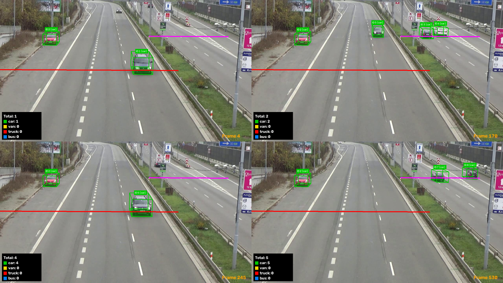
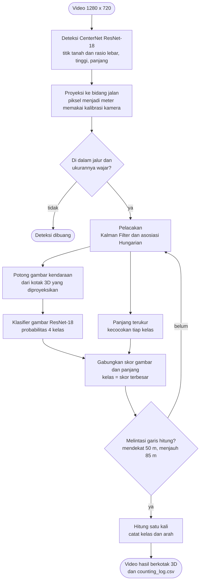
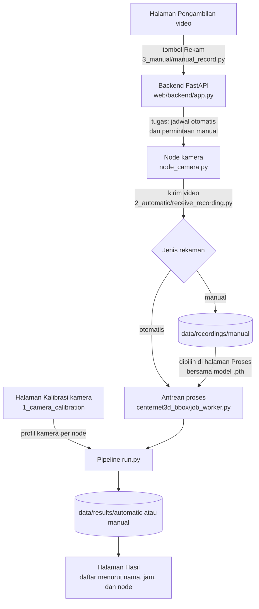
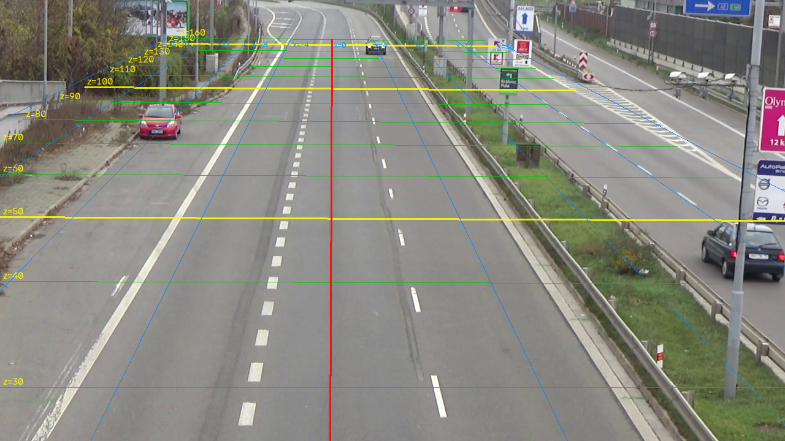
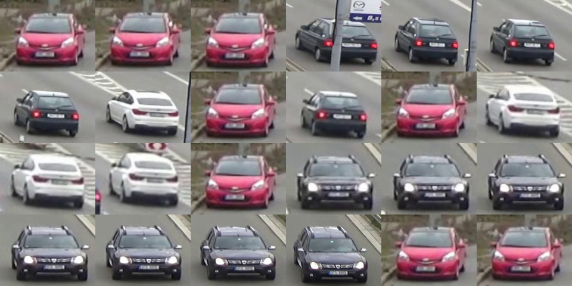

# 3D Vehicle Detection, Classification, and Counting

Sistem deteksi kotak 3D, pelacakan, klasifikasi 4 kelas, dan penghitungan kendaraan dari satu kamera jalan raya, lengkap dengan antarmuka web dan program node kamera (Raspberry Pi / IP camera). Dikerjakan sebagai Tugas Akhir D3 Teknologi Komputer, Institut Teknologi Del, oleh Angeleno Zuliano Hutapea.

Detektor yang dipakai adalah CenterNet (ResNet-18) yang meregresikan kotak 3D kendaraan, tanpa YOLO. Ide keluaran detektor berangkat dari proyek [antoinekeller/3d_bbox_highway](https://github.com/antoinekeller/3d_bbox_highway); nilai yang diwarisi dari proyek itu ditandai `[kode asal]` di `config.py`.



> **Status:** repo ini berisi tahap latihan memakai data publik `session0_right` (BrnoCompSpeed). Kamera milik proyek belum terpasang; saat terpasang, kalibrasi, letak garis, dan bobot model perlu disesuaikan (lihat [Pindah ke kamera sendiri](#pindah-ke-kamera-sendiri)).

## Daftar isi

- [Struktur folder](#struktur-folder)
- [Cara kerja](#cara-kerja)
- [Pemasangan](#pemasangan)
- [Antarmuka web](#antarmuka-web)
- [Menjalankan pipeline dari terminal](#menjalankan-pipeline-dari-terminal)
- [Node kamera](#node-kamera)
- [Evaluasi hitungan terhadap ground truth](#evaluasi-hitungan-terhadap-ground-truth)
- [Hasil](#hasil)
- [Melatih ulang model](#melatih-ulang-model)
- [Setelan penting](#setelan-penting)
- [Keterbatasan](#keterbatasan)
- [Pindah ke kamera sendiri](#pindah-ke-kamera-sendiri)
- [Rujukan](#rujukan)

## Struktur folder

Proyek dibagi menjadi **tiga bagian utama** sesuai cara sistem dipakai, ditambah inti sistem, antarmuka web, dan data.

```
3d-vehicle-detection-counting/
├── 1_camera_calibration/        UTAMA 1 - kalibrasi kamera per node
│   ├── calibration.py             baca/simpan profil; cara 1: impor XML, cara 2: isi nilai manual
│   ├── calibration_preview.py     gambar kisi jalan, garis hitung, dan kotak acuan di atas frame
│   ├── camera_profiles/           satu profil .json per node (mis. session0_right.json)
│   └── xml/                       berkas kalibrasi (session0_right_calibParams.xml)
├── 2_automatic/                 UTAMA 2 - rekam sesuai jadwal, langsung diproses
│   ├── schedule.json              jumlah video per hari, durasi, jam mulai/selesai
│   ├── schedule.py                jam rekam hari ini, jam yang sudah direkam
│   ├── receive_recording.py       tugas untuk node + menerima unggahan node
│   └── auto_process.py            rekaman otomatis langsung masuk antrean proses
├── 3_manual/                    UTAMA 3 - rekam tombol / unggah, diproses saat dipilih
│   ├── manual_record.py           tombol Rekam -> permintaan ke node
│   ├── upload_video.py            unggah, daftar, dan hapus rekaman
│   └── manual_process.py          proses video terpilih dengan bobot .pth terpilih
├── centernet3d_bbox/            inti sistem (dipakai ketiga bagian)
│   ├── pipeline/                  deteksi -> pelacakan -> klasifikasi -> penghitungan (run.py, config.py, ...)
│   ├── job_worker.py              antrean pemrosesan video
│   ├── node/                      node_camera.py + contoh layanan systemd
│   ├── training/                  train_detector/, train_classifier/
│   └── tools/                     evaluate_count.py, atcs_medan.py, sort_crops.py
├── web/                         antarmuka web
│   ├── backend/                   app.py (FastAPI), settings.py, run.sh
│   └── frontend/                  index.html, app.js, style.css
├── docs/experiments/            hasil eksperimen untuk laporan (log latih, evaluasi, ground truth, gambar)
├── notebooks/                   full_notebook.ipynb
├── requirements.txt
└── data/                        TIDAK masuk Git (lihat di bawah)
    ├── settings.json              token node, daftar node, izin jaringan
    ├── weights/                   detector/*.pth, classifier/*.pth
    ├── recordings/                automatic/<node>/, manual/<node>/
    ├── results/                   automatic/<job>/, manual/<job>/, cli/
    ├── test_videos/               video uji
    └── dataset -> ~/dataset_publik
```

Hubungan halaman web dengan folder:

| Halaman web | Folder yang dipakai |
|---|---|
| Kalibrasi kamera | `1_camera_calibration/` |
| Pengambilan video, bagian jadwal | `2_automatic/` |
| Pengambilan video, tombol Rekam dan unggah | `3_manual/` |
| Proses | `3_manual/manual_process.py` + `centernet3d_bbox/` |
| Hasil | `data/results/automatic/` dan `data/results/manual/` |

### Yang tidak ada di repo ini

Folder `data/` tidak diunggah karena berukuran besar atau berisi token. Yang perlu disiapkan sendiri:

| Berkas | Lokasi | Keterangan |
|---|---|---|
| Bobot detektor `centernet_dari_baru.pth` | `data/weights/detector/` | hasil latihan sendiri pada session0_right |
| Bobot klasifier `klas_ft2.pth` | `data/weights/classifier/` | hasil latihan sendiri |
| Video uji | `data/test_videos/` | dibuat dari frame 2545–3181 session0_right |
| Setelan server | `data/settings.json` | dibuat otomatis saat server pertama dijalankan; berisi token node |
| Data `session0_right` | `~/projects/data_session0_right/` | 3.182 frame 1920 × 1080 dengan anotasi kotak 3D per frame; dipakai pelatihan dan evaluasi |
| Dataset klasifikasi | `~/dataset_publik/` | MIO-TCD disusun menjadi 4 kelas, ditambah potongan ATCS Medan |

## Cara kerja



Semua berkas di tabel ini ada di `centernet3d_bbox/pipeline/`.

| Tahap | Berkas | Keterangan |
|---|---|---|
| Deteksi | `detector.py` | CenterNet ResNet-18, stride 32. Keluarannya titik sentuh tanah kendaraan dan rasio lebar/tinggi/panjang; tidak ada kotak 2D. |
| Proyeksi dan filter | `geometry.py`, `detection_filter.py` | Titik piksel diproyeksikan ke bidang jalan memakai kalibrasi kamera, sehingga posisi dan ukuran didapat dalam meter. Deteksi di luar jalur atau berukuran tidak wajar dibuang. |
| Cache deteksi | `detection_cache.py` | Deteksi mentah disimpan (`.det.pkl`), sehingga pemrosesan ulang video yang sama jauh lebih cepat. |
| Pelacakan | `tracker.py`, `kalman_filter.py` | Kalman Filter kecepatan konstan dan asosiasi Hungarian. Asosiasi dua tahap ala ByteTrack aktif bila `--conf-low` diberikan. |
| Kotak 3D tampilan | `box3d.py` | Ukuran kotak = campuran templat kelas dan ukuran terukur; arah dari lintasan. |
| Klasifikasi | `classifier.py`, `image_classifier.py` | Empat kelas: `car`, `van`, `truck`, `bus`. Probabilitas klasifier gambar (ResNet-18) digabung dengan prior panjang terukur, dirata-rata sepanjang hidup track. |
| Penghitungan | `counter.py` | Kendaraan dihitung satu kali saat melintasi garis virtual. Ada dua garis: satu untuk jalur yang mendekat, satu untuk jalur yang menjauh. |
| Tampilan | `visualize.py` | Kotak 3D, label, dan panel hitungan berwarna per kelas. |

### Klasifikasi: gambar digabung panjang

Detektor hanya punya satu kanal heatmap, jadi tidak membedakan jenis kendaraan. Kelas ditentukan dari dua bukti:

1. **Gambar.** Potongan gambar kendaraan diambil dari kotak 3D yang diproyeksikan ke citra, lalu diklasifikasi ResNet-18 (masukan 128 × 128, letterbox).
2. **Panjang terukur.** Tiap kelas punya rentang panjang (`LIMITS` di `config.py`); di dalam rentang prior bernilai 1 dan meluruh di luarnya.

Skor per kelas:

```
skor[c] = (rata-rata probabilitas gambar[c] + ε) × (rata-rata prior panjang[c] + ε)
```

Kelas akhir adalah skor terbesar. Panjang tidak bisa membedakan `truck` dan `bus` (rentangnya tumpang tindih), jadi keduanya hanya dibedakan oleh gambar. Dengan opsi `--tanpa-gambar`, kelas ditentukan dari panjang saja.

| Kelas | Warna kotak |
|---|---|
| `car` | hijau |
| `van` | kuning |
| `truck` | merah |
| `bus` | biru |

## Pemasangan

Diuji pada Ubuntu dengan Python 3.12, tanpa GPU.

```bash
git clone https://github.com/lenohutapea/3d-vehicle-detection-counting.git
cd 3d-vehicle-detection-counting
python3 -m venv ~/projects/venv_3dbbox
source ~/projects/venv_3dbbox/bin/activate
pip install -r requirements.txt --extra-index-url https://download.pytorch.org/whl/cpu
sudo apt install ffmpeg        # agar video hasil berformat H.264 dan bisa diputar di peramban
```

Lalu letakkan bobot dan video uji di `data/` sesuai tabel [Yang tidak ada di repo ini](#yang-tidak-ada-di-repo-ini).

`web/backend/run.sh` memakai venv di `~/projects/venv_3dbbox`. Bila venv diletakkan di tempat lain, jalankan dengan `VENV=/jalur/venv ./web/backend/run.sh`.

## Antarmuka web

Antarmuka menjalankan `pipeline/run.py` yang sama dengan terminal, jadi hasilnya sama. Backend memakai FastAPI; halaman web memakai HTML, CSS, dan JavaScript biasa tanpa pustaka tambahan.

```bash
./web/backend/run.sh
```

Lalu buka `http://127.0.0.1:8000` di peramban.



| Halaman | Fungsi |
|---|---|
| Pengambilan video | Memilih node, melihat status node, melihat jadwal otomatis, merekam manual, mengunggah video, dan melihat daftar rekaman. |
| Kalibrasi kamera | Mengatur sudut, tinggi, dan focal kamera per node dengan pratinjau langsung, atau mengunggah berkas kalibrasi. Garis hitung, median, dan lebar jalur juga diatur di sini. |
| Proses | Memilih video, profil kamera (node), dan bobot model `.pth`, lalu memprosesnya. |
| Hasil | Daftar semua video yang diproses, disaring menurut nama, tanggal rekam, dan node. Tiap hasil menampilkan video, hitungan per kelas dan arah, grafik, dan tabel kendaraan. |

### Otomatis dan manual

- **Otomatis.** Jadwalnya ditulis di `2_automatic/schedule.json` (contoh: 6 video per hari, 60 detik per video, pukul 06.00–18.00). Halaman hanya menampilkannya. Rekaman otomatis langsung diproses dengan model bawaan, dan hasilnya disimpan di `data/results/automatic/`.
- **Manual.** Direkam saat tombol ditekan, atau diunggah dari berkas. Rekaman manual hanya disimpan di `data/recordings/manual/`, lalu dipilih sendiri di halaman Proses. Hasilnya disimpan di `data/results/manual/`.

### Profil kamera

Kalibrasi dan garis hitung disimpan per node di `1_camera_calibration/camera_profiles/<node>.json`. Saat sebuah video diproses, profil node-nya diberikan ke pipeline lewat variabel lingkungan `PROFIL_KAMERA`, dan `config.py` menimpa nilai bawaannya dengan isi profil itu. Tanpa variabel tersebut, `config.py` berlaku apa adanya.

### Keamanan

Halaman web dan API-nya hanya melayani komputer server sendiri (`127.0.0.1`). Dua pengecualian:

- alamat `/api/node/...` untuk node kamera selalu dilayani dari jaringan, tetapi wajib membawa token (`X-Token`) dari `data/settings.json`;
- bila `"izinkan_publik": true` di `data/settings.json`, halaman web juga dilayani lewat Cloudflare Tunnel. Halaman web belum memiliki login, jadi siapa pun yang tahu alamatnya bisa memakai semua fitur.

## Menjalankan pipeline dari terminal

```bash
source ~/projects/venv_3dbbox/bin/activate
cd centernet3d_bbox/pipeline
python3 run.py ../../data/test_videos/uji_val_720p.mp4 \
    ../../data/weights/detector/centernet_dari_baru.pth \
    --cache ../../data/test_videos/det_session0.pkl \
    --conf 0.4 --conf-low 0.2 --no-show --line-y 50
```

Keluaran:

- video hasil di `data/results/cli/<nama_video>_hasil.mp4`;
- `counting_log.csv` di folder `pipeline/`: satu baris per kendaraan yang dihitung (frame, ID, kelas, ukuran, posisi, skor tiap kelas);
- ringkasan hitungan per kelas di terminal.

Video masukan harus 1280 × 720, sesuai kalibrasi dan detektor. Lewat antarmuka web, video dengan ukuran lain diubah ukurannya otomatis.

| Opsi | Fungsi |
|---|---|
| `--conf` | ambang skor deteksi yang boleh membuat track baru |
| `--conf-low` | ambang skor rendah; deteksi di antaranya hanya menyambung track yang sudah ada |
| `--cache BERKAS` | simpan atau muat deteksi mentah, sehingga jalan berikutnya jauh lebih cepat |
| `--line-y` | garis hitung jalur yang mendekat (meter dari kamera) |
| `--line-y-away` | garis hitung jalur yang menjauh (bawaan 85 m) |
| `--klas BERKAS` | bobot klasifier gambar |
| `--tanpa-gambar` | klasifikasi dari panjang saja |
| `--simpan-crop FOLDER` | simpan potongan gambar yang dikirim ke klasifier, untuk diperiksa |
| `--out BERKAS` | nama video hasil |
| `--png` | simpan juga PNG tiap frame |
| `--no-save` | tidak menyimpan video |
| `--no-show` | tanpa jendela pratinjau |
| `--debug` | tandai deteksi mentah yang lolos dan yang ditolak filter |

## Node kamera

Node kamera menjalankan `centernet3d_bbox/node/node_camera.py`, yang hanya memakai pustaka bawaan Python. Program itu bertanya ke server tiap 5 detik, merekam pada jam jadwal atau saat ada permintaan manual, lalu mengirim videonya.

```bash
# Raspberry Pi dengan Camera Module (rpicam-vid)
python3 node_camera.py --server https://DOMAIN_ANDA --node kamera1 --token TOKEN

# IP camera (RTSP), dijalankan di Raspberry Pi atau di server
python3 node_camera.py --server http://127.0.0.1:8000 --node kamera1 --token TOKEN \
    --perintah "ffmpeg -y -loglevel error -rtsp_transport tcp -i 'rtsp://USER:PASS@IP:554/stream1' -t {detik} -an -c:v copy {keluar}"

# uji tanpa kamera: kamera tiruan dari berkas video (butuh ffmpeg)
python3 node_camera.py --server http://127.0.0.1:8000 --node kamera1 --token TOKEN \
    --sumber data/test_videos/uji_val_720p.mp4 --sekali
```

- `TOKEN` adalah nilai `token_node` di `data/settings.json`. Jangan diunggah atau dibagikan di tempat umum.
- `--node` harus terdaftar di bagian `node` pada `data/settings.json`.
- Agar node berjalan otomatis saat menyala, salin `centernet3d_bbox/node/node-camera.service` ke `/etc/systemd/system/` dan sesuaikan isinya.
- Bila node mengirim lewat Cloudflare Tunnel, batas unggahnya 100 MB per video. Rekaman 720p sebaiknya tidak lebih dari sekitar 60 detik.

## Evaluasi hitungan terhadap ground truth

`centernet3d_bbox/tools/evaluate_count.py` menghitung jumlah kendaraan yang sebenarnya melintasi garis dari anotasi XML session0_right, lalu mencocokkannya dengan `counting_log.csv`. Anotasi tidak memuat ID antar-frame, jadi skrip menghubungkan sendiri objek antar-frame di bidang jalan.

```bash
cd centernet3d_bbox/pipeline
python3 ../tools/evaluate_count.py --ann ~/projects/data_session0_right/annotations \
    --first 2545 --last 3181 --line 50 --log counting_log.csv
```

Skrip melaporkan TP, FP, FN, presisi, recall, dan selisih panjang terukur terhadap anotasi. Ground truth hasil hitungan untuk klip uji tersimpan di `docs/experiments/counting/gt_hitung.csv`.

## Hasil

Diuji pada frame 2545–3181 `session0_right` (637 frame, sekitar 25 detik). Rentang ini tidak dipakai saat melatih detektor.

| Ukuran | Nilai |
|---|---|
| Kendaraan melintasi garis menurut anotasi | 6 (2 mendekat, 4 menjauh) |
| Dihitung pipeline | 6 |
| TP / FP / FN | 6 / 0 / 0 |
| Kelas | 6 `car`, sesuai isi klip |
| Skor kelas `car` | 0,96–0,98 |
| Selisih panjang di garis 50 m | +0,3 sampai +0,4 m |
| Selisih panjang di garis 85 m | +0,1 sampai +1,2 m |

Kalibrasi kamera dan potongan gambar yang dikirim ke klasifier:





Log latihan detektor ada di `docs/experiments/log_latih_detektor/`, dan hasil evaluasi detektor pada data validasi ada di `docs/experiments/prediksi_detektor/`.

## Melatih ulang model

> Skrip pelatihan masih memakai jalur bawaan lama (`~/projects/data_session0_right`, `~/projects/acuan/3d_bbox_highway`, `~/projects/hasil/...`). Berikan jalur lain lewat argumen bila data diletakkan di tempat lain; lihat `--help` tiap skrip.

### Detektor

```bash
cd centernet3d_bbox/training/train_detector
python3 train_session0_right.py --init BOBOT_AWAL.pth --out ../../../data/weights/detector/NAMA.pth
python3 prediksi.py --help        # membuat berkas prediksi
python3 evaluasi.py --pred JALUR/NAMA_val.pkl
```

Data dibagi berurutan: frame 0–2544 untuk latihan dan 2545–3181 untuk uji. Sesuai arahan dosen pembimbing, latihan dijalankan dari dua bobot awal: bobot asli proyek asal (`centernet_dari_lama.pth`) dan bobot hasil latihan sendiri (`centernet_dari_baru.pth`). Log keduanya ada di `docs/experiments/log_latih_detektor/`.

### Klasifier gambar

```bash
cd centernet3d_bbox/training/train_classifier
python3 latih_klasifikasi.py --epochs 5 --tag klas5
python3 latih_klasifikasi.py --init ../../../data/weights/classifier/klas5.pth --tambah-session \
    --epochs 3 --max-per-class 3000 --lr 1e-4 --tag klas_ft2
```

Langkah pertama melatih ResNet-18 (bobot awal ImageNet) pada MIO-TCD. Langkah kedua menyesuaikannya dengan sudut pandang kamera `session0_right` memakai potongan gambar dari frame latihan. Penyesuaian ini diperlukan karena MIO-TCD kebanyakan berisi tampak samping, sedangkan kamera ini melihat kendaraan dari depan dan belakang.

Untuk menambah data lokal dari Sumatera Utara:

```bash
python3 centernet3d_bbox/tools/atcs_medan.py lihat data/dataset/atcs_medan/mentah
python3 centernet3d_bbox/tools/sort_crops.py data/dataset/atcs_medan/potongan   # pilah manual ke 4 kelas
```

## Setelan penting

Semua ada di `centernet3d_bbox/pipeline/config.py`. Nilai kalibrasi dan garis hitung bisa ditimpa per node lewat halaman Kalibrasi.

| Setelan | Nilai | Arti |
|---|---|---|
| `CALIB_XML` | `1_camera_calibration/xml/session0_right_calibParams.xml` | sumber parameter kamera (focal, tinggi, titik hilang) |
| `LANE_HALF_WIDTH_M` | 20 | deteksi di luar ±20 m dari sumbu kamera dibuang |
| `MAX_TRACK_DEPTH_M` | 105 | track lebih jauh dari ini dihapus |
| `LINE_Y_DEFAULT_M` | 50 | garis hitung jalur mendekat |
| `LINE_Y_AWAY_M` | 85 | garis hitung jalur menjauh |
| `MEDIAN_X_M` | 7 | batas lateral antara dua arah |
| `CLASSES` | `car`, `van`, `truck`, `bus` | kelas dan urutan prioritas saat skor seri |
| `KLAS_MODEL` | `data/weights/classifier/klas_ft2.pth` | bobot klasifier gambar |

Jalur menjauh memakai garis yang lebih jauh karena kendaraannya masuk dari tepi kanan gambar dan baru terlihat pada jarak lebih dari 54 m, sehingga tidak pernah melintasi garis 50 m.

## Keterbatasan

- **Sampel uji kecil.** Hasil di atas berasal dari 6 kendaraan dalam satu klip, jadi belum bisa disebut angka akurasi.
- **Kelas selain `car` belum teruji pada video.** Klip uji hanya berisi mobil. `van`, `truck`, dan `bus` baru teruji pada potongan gambar, belum di dalam pipeline.
- **Panjang kurang akurat di jarak jauh.** Selisihnya sampai sekitar 1,2 m pada jarak 85 m.
- **Kecepatan bingkai video uji diasumsikan 25 fps.** Kecepatan kendaraan tidak dipakai dan bukan bagian dari cakupan.
- **Ambang dan cara penggabungan klasifikasi bersifat heuristik**, dipilih dari pengujian pada data ini.
- **Klasifier disesuaikan dengan kamera `session0_right`.** Pada kamera lain perlu disesuaikan ulang.
- **Tanpa GPU, deteksi berjalan sekitar 2–3 frame per detik.** Video 60 detik diproses sekitar 10 menit, jadi belum real-time.
- **Perekaman dari node belum diuji dengan kamera asli.** Yang diuji baru kamera tiruan dari berkas video.
- **Halaman web belum memiliki login.**

## Pindah ke kamera sendiri

Kode tidak perlu diubah. Yang perlu dilakukan:

1. daftarkan node baru di `data/settings.json`;
2. kalibrasi kamera (tinggi, sudut, focal) lewat halaman Kalibrasi kamera, atau unggah berkas kalibrasi sendiri;
3. atur batas jalur, median, dan letak kedua garis hitung di halaman yang sama;
4. latih ulang detektor dengan data kamera tersebut;
5. sesuaikan klasifier dengan potongan gambar dari kamera tersebut.

## Rujukan

- X. Zhou, D. Wang, P. Krähenbühl, "Objects as Points," arXiv:1904.07850, 2019.
- A. Bewley dkk., "Simple Online and Realtime Tracking," ICIP 2016.
- Y. Zhang dkk., "ByteTrack: Multi-Object Tracking by Associating Every Detection Box," ECCV 2022.
- K. He, X. Zhang, S. Ren, J. Sun, "Deep Residual Learning for Image Recognition," CVPR 2016.
- Z. Luo dkk., "MIO-TCD: A New Benchmark Dataset for Vehicle Classification and Localization," IEEE Transactions on Image Processing, 2018.
- J. Sochor dkk., "Comprehensive Data Set for Automatic Single Camera Visual Speed Measurement," IEEE Transactions on Intelligent Transportation Systems, 2018.
- A. Keller, [3d_bbox_highway](https://github.com/antoinekeller/3d_bbox_highway), proyek asal ide keluaran detektor.
- C. Ginting, [Dataset ATCS Medan](https://universe.roboflow.com/christanta-ginting-ghwse/dataset-atcs-medan), Roboflow Universe, 2023 (CC BY 4.0).
